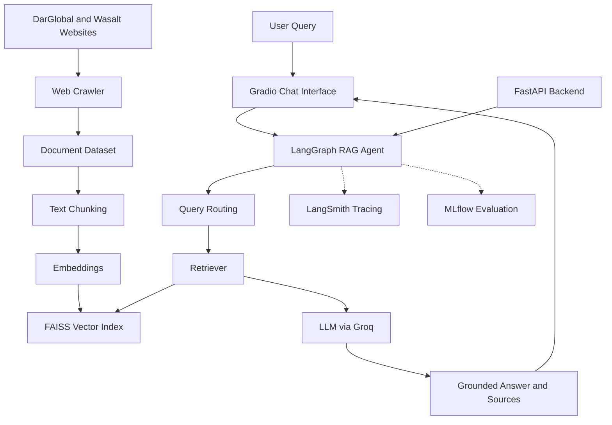

---
title: DarGlobal x Wasalt AI Assistant
emoji: 🏡
colorFrom: blue
colorTo: green
sdk: gradio
sdk_version: "6.32.0"
app_file: app.py
pinned: false
---

# DarGlobal × Wasalt — AI-Powered RAG Chatbot

An AI-powered real estate assistant that answers questions about DarGlobal and Wasalt using Retrieval-Augmented Generation (RAG).

Built with Python, LangGraph, FastAPI, Gradio, FAISS, Groq, LangSmith and MLflow.

## Project Overview

This project provides an intelligent conversational assistant that helps users explore information about DarGlobal and Wasalt.

The assistant retrieves relevant information from indexed website content and generates context-grounded answers with source references.

## Key Features

- **RAG Pipeline:** Retrieves relevant information from indexed documents.
- **LangGraph:** Handles query routing and multi-step retrieval workflows.
- **Gradio Interface:** Provides an interactive chatbot experience.
- **FastAPI:** Provides the backend API.
- **FAISS:** Performs vector-based similarity search.
- **Groq:** Provides LLM inference.
- **FastEmbed:** Generates document embeddings.
- **LangSmith:** Supports tracing and debugging.
- **MLflow:** Tracks evaluation experiments and metrics.
- **Docker:** Supports containerized application deployment.
- **GitHub Actions:** Automates CI and deployment workflows.
- **Source References:** Includes relevant source URLs in chatbot responses.
- **Evaluation:** Includes curated QA test cases and evaluation metrics.

## Architecture



## Technology Stack

| Category | Technologies |
|---|---|
| Language | Python |
| LLM Provider | Groq |
| Agent Framework | LangGraph |
| Retrieval | FAISS |
| Embeddings | FastEmbed |
| Backend | FastAPI |
| Frontend | Gradio |
| Observability | LangSmith |
| Experiment Tracking | MLflow |
| Containerization | Docker |
| CI/CD | GitHub Actions |
| Testing | Pytest |
| Code Quality | Ruff |

## Evaluation Results

Latest recorded evaluation results:

| Metric | Result |
|---|---:|
| Total Questions | 20 |
| Passed | 20 |
| Failed | 0 |
| Accuracy | 100% |
| Average Score | 100% |
| Average Latency | 2.51 seconds |

Evaluation results are available in `eval/eval_results.json`.

## Project Structure

```text
.
├── app/
│   ├── graph.py
│   ├── main.py
│   ├── tracking.py
│   └── static/
├── data/
├── docs/
├── eval/
│   ├── qa.json
│   ├── run_eval.py
│   └── eval_results.json
├── tests/
├── .github/
│   └── workflows/
│       ├── ci.yml
│       └── deploy.yml
├── app.py
├── Dockerfile
├── docker-compose.yml
├── ingest.py
├── scrape.py
├── requirements.txt
├── requirements-dev.txt
└── README.md
```

## Getting Started

### 1. Clone the Repository

```bash
git clone https://github.com/osamashabih6960/DarGlobal-Wasalt-AI-Powered-RAG-Chatbot.git

cd DarGlobal-Wasalt-AI-Powered-RAG-Chatbot
```

### 2. Create a Virtual Environment

```bash
python -m venv .venv
```

Activate on Windows PowerShell:

```powershell
.\.venv\Scripts\Activate.ps1
```

### 3. Install Dependencies

```powershell
python -m pip install -r requirements-dev.txt
```

### 4. Configure Environment Variables

```powershell
Copy-Item .env.example .env
```

Add your required API credentials to `.env`.

Never commit API keys or secrets.

### 5. Build the Dataset and Vector Index

```powershell
python .\scrape.py
python .\ingest.py
```

### 6. Run the Gradio Chatbot

```powershell
python .\app.py
```

Open:

http://127.0.0.1:7860

### 7. Run the FastAPI Backend

```powershell
uvicorn app.main:app --host 0.0.0.0 --port 8000
```

API documentation:

http://127.0.0.1:8000/docs

Health endpoint:

http://127.0.0.1:8000/health

### 8. Run Evaluation

```powershell
python .\eval\run_eval.py
```

### 9. Run with Docker

```bash
docker compose up --build
```

## Hugging Face Deployment

The chatbot is configured for deployment using Hugging Face Spaces with the Gradio SDK.

Live Space:

https://huggingface.co/spaces/osamashabih/wasalt-chatbot

Deployment workflow:

1. Push changes to the GitHub main branch.
2. GitHub Actions executes the CI workflow.
3. After successful CI, the deployment workflow pushes the project to Hugging Face Spaces.
4. Hugging Face builds and launches the Gradio application.

### Required Hugging Face Secret

Configure the following secret in Hugging Face Space Settings → Variables and secrets:

- `GROQ_API_KEY`

Never expose API keys in source code or GitHub commits.

## Monitoring and Evaluation

- LangSmith is used for tracing and debugging LLM workflows.
- MLflow is used for evaluation experiment tracking.
- Evaluation results are stored in `eval/eval_results.json`.
- Pytest is used for automated testing.

## Data and Responsible Usage

The project uses publicly accessible DarGlobal and Wasalt website content.

Crawling and indexing are performed for retrieval and experimentation. Crawling respects applicable website access restrictions and does not bypass authentication or access controls.

Generated datasets and vector indexes are excluded from the Git repository where appropriate.

## Future Improvements

- Hybrid search with BM25 and vector retrieval.
- Retrieval relevance thresholds.
- True token streaming.
- Scheduled data refresh.
- Expanded evaluation coverage.
- Multilingual chatbot support.
- Improved source-grounding and answer verification.
- Production monitoring and performance optimization.

## Author

**Osama Shabih**

GitHub: https://github.com/osamashabih6960

Project Repository:

https://github.com/osamashabih6960/DarGlobal-Wasalt-AI-Powered-RAG-Chatbot
