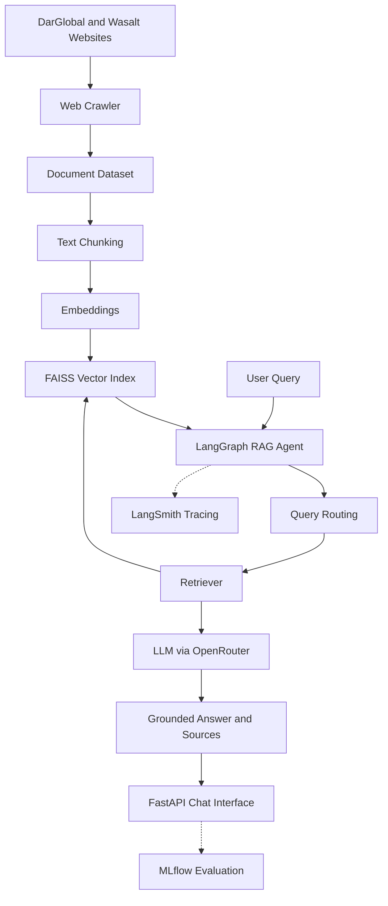

---
title: DarGlobal x Wasalt AI Assistant
sdk: docker
app_port: 7860
---

# DarGlobal × Wasalt — AI-Powered RAG Chatbot

An AI-powered real estate assistant that answers questions about DarGlobal and Wasalt using Retrieval-Augmented Generation (RAG).

Built with LangGraph, FastAPI, FAISS, OpenRouter, LangSmith and MLflow.

## Project Overview

This project provides a conversational interface for users to explore information about DarGlobal and Wasalt.

The assistant retrieves relevant information from indexed website content and generates context-grounded answers with source references.

### Key Features

- **RAG Pipeline:** Retrieves relevant information from indexed documents.
- **LangGraph:** Handles query routing and multi-step retrieval workflows.
- **FastAPI:** Provides the backend API and chatbot interface.
- **FAISS:** Performs vector-based similarity search.
- **OpenRouter:** Provides LLM inference with fallback models.
- **LangSmith:** Supports tracing and debugging.
- **MLflow:** Tracks evaluation experiments and metrics.
- **Docker:** Containerized application deployment.
- **GitHub Actions:** Automated CI and deployment workflows.
- **Evaluation:** 20 curated QA test cases with a 100% pass rate.

## Architecture



## Technology Stack

| Category | Technologies |
|---|---|
| Language | Python |
| LLM | OpenRouter |
| Agent Framework | LangGraph |
| Retrieval | FAISS |
| Embeddings | FastEmbed |
| Backend | FastAPI |
| Observability | LangSmith |
| Experiment Tracking | MLflow |
| Containerization | Docker |
| CI/CD | GitHub Actions |

## Evaluation Results

Latest evaluation run:

| Metric | Result |
|---|---:|
| Total Questions | 20 |
| Passed | 20 |
| Failed | 0 |
| Accuracy | 100% |
| Average Score | 100% |
| Average Latency | 2.51 seconds |

Evaluation results are available in `eval/eval_results.json`.

## Project Structure

```text
.
├── app/
│   ├── graph.py
│   ├── main.py
│   ├── tracking.py
│   └── static/
├── data/
│   └── dataset manifests
├── docs/
├── eval/
│   ├── qa.json
│   ├── run_eval.py
│   └── eval_results.json
├── tests/
├── .github/
│   └── workflows/
├── Dockerfile
├── docker-compose.yml
├── ingest.py
├── scrape.py
├── requirements.txt
└── requirements-dev.txt
```

## Getting Started

### 1. Clone the Repository

```bash
git clone https://github.com/osamashabih6960/DarGlobal-Wasalt-AI-Powered-RAG-Chatbot.git

cd DarGlobal-Wasalt-AI-Powered-RAG-Chatbot
```

### 2. Create a Virtual Environment

```bash
python -m venv .venv
```

Activate on Windows PowerShell:

```powershell
.\.venv\Scripts\Activate.ps1
```

### 3. Install Dependencies

```bash
pip install -r requirements-dev.txt
```

### 4. Configure Environment Variables

```powershell
Copy-Item .env.example .env
```

Add your own API credentials to `.env`.

Never commit API keys or secrets.

### 5. Build the Dataset and Vector Index

```bash
python .\scrape.py
python .\ingest.py
```

### 6. Run the Application

```bash
uvicorn app.main:app --host 0.0.0.0 --port 7860
```

Open:

http://localhost:7860

### 7. Run Evaluation

```bash
python .\eval\run_eval.py
```

### 8. Run with Docker

```bash
docker compose up --build
```

## Monitoring and Evaluation

- LangSmith is used for tracing and debugging LLM workflows.
- MLflow is used for evaluation experiment tracking.
- Evaluation results are stored in `eval/eval_results.json`.

## Data and Responsible Usage

The project uses publicly accessible DarGlobal and Wasalt website content.

Crawling and indexing are performed for retrieval and experimentation. Generated datasets and vector indexes are excluded from the Git repository.

## Future Improvements

- Hybrid search with BM25 and vector retrieval.
- Retrieval relevance thresholds.
- True token streaming.
- Scheduled data refresh.
- Expanded evaluation coverage.

## Author

**Osama Shabih**

GitHub: [@osamashabih6960](https://github.com/osamashabih6960)

Project Repository: [DarGlobal-Wasalt-AI-Powered-RAG-Chatbot](https://github.com/osamashabih6960/DarGlobal-Wasalt-AI-Powered-RAG-Chatbot)
