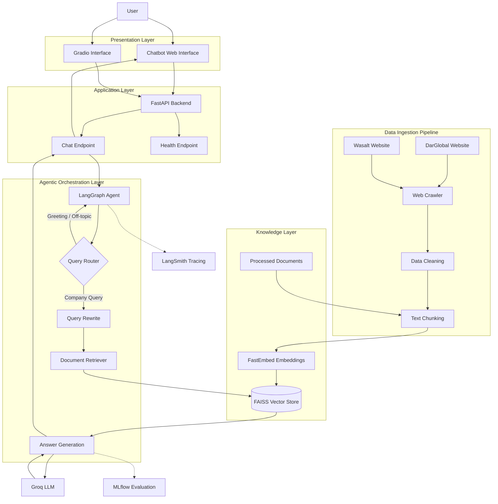
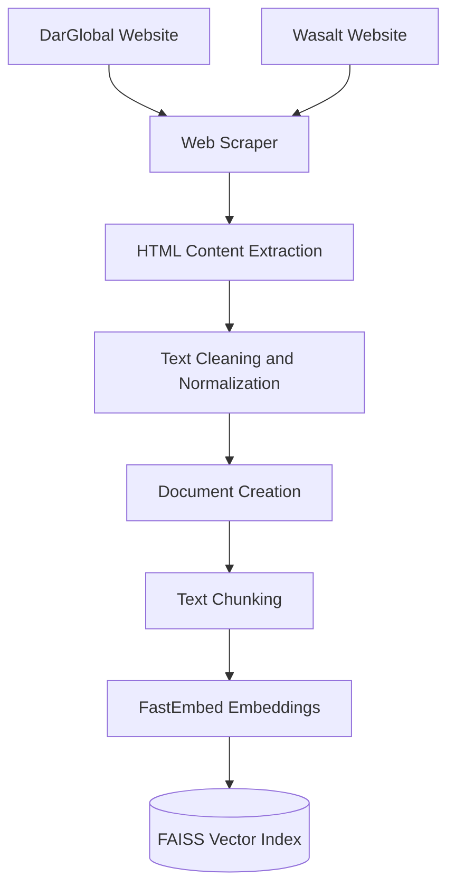
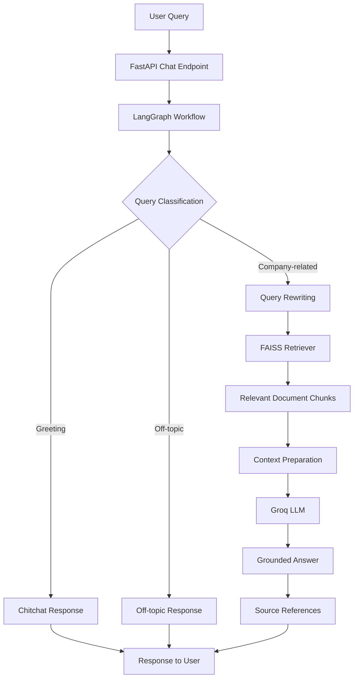
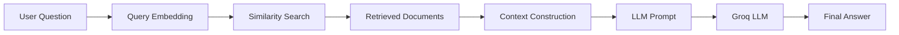
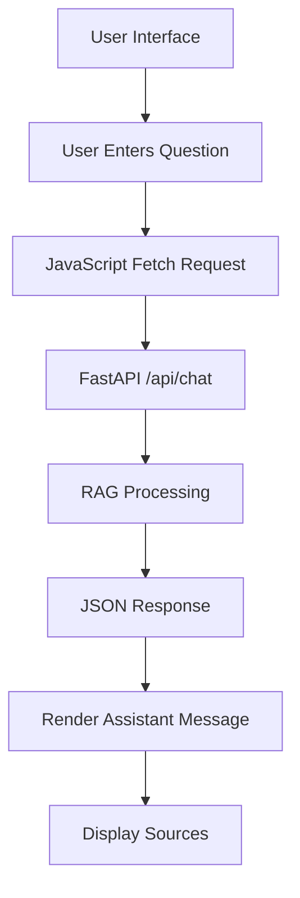
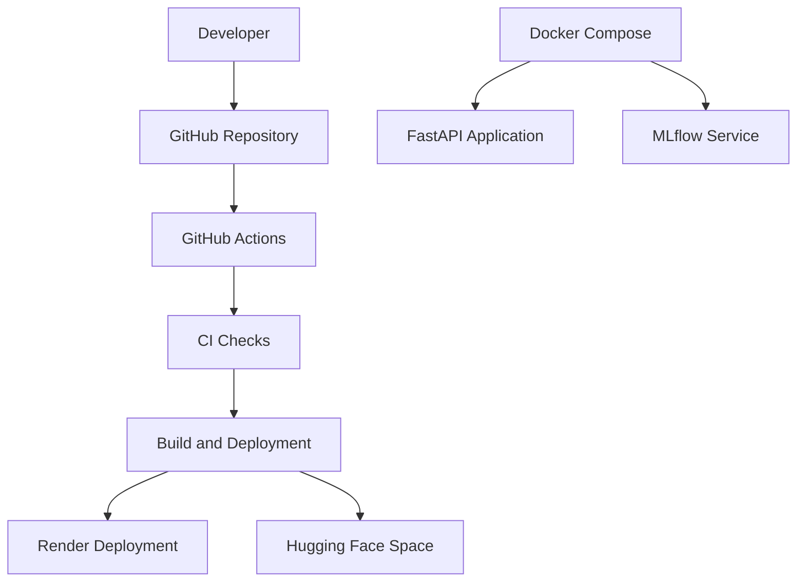
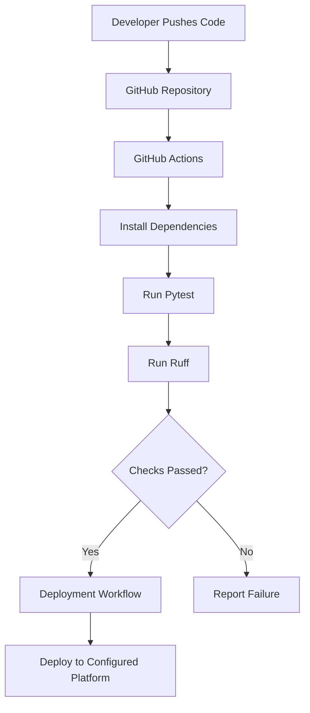

# 🏡 DarGlobal × Wasalt — AI-Powered Real Estate Assistant

<p align="center">
  <b>An intelligent Retrieval-Augmented Generation (RAG) chatbot for DarGlobal and Wasalt.</b>
</p>

<p align="center">
  <a href="https://darglobal-wasalt-ai-powered-rag-chatbot.onrender.com/">Live Demo</a> •
  <a href="https://huggingface.co/spaces/osamashabih/wasalt-chatbot">Hugging Face Space</a> •
  <a href="https://github.com/osamashabih6960/DarGlobal-Wasalt-AI-Powered-RAG-Chatbot">GitHub Repository</a>
</p>

---

## 1. Project Overview

**DarGlobal × Wasalt AI Assistant** is an AI-powered real estate chatbot designed to answer user questions about DarGlobal and Wasalt using Retrieval-Augmented Generation (RAG).

Instead of relying entirely on an LLM's pretrained knowledge, the system retrieves relevant information from indexed website content and uses that information to generate context-grounded responses.

The project combines web crawling, document processing, vector embeddings, semantic search, agentic workflow orchestration, LLM inference, API development, evaluation, observability, and deployment.

### What Problem Does It Solve?

Users often need to search across multiple web pages to find information about real estate companies, projects, property listings, and services.

This assistant provides a conversational interface where users can ask questions in natural language and receive relevant answers supported by retrieved sources.

### Project Goals

- Build an end-to-end RAG application.
- Collect and process publicly available website content.
- Implement semantic search using vector embeddings.
- Orchestrate multi-step AI workflows using LangGraph.
- Generate context-aware responses using an LLM.
- Provide source references for transparency.
- Expose chatbot functionality through FastAPI.
- Build an interactive chatbot interface.
- Evaluate response quality and application reliability.
- Deploy the application using cloud and container technologies.

---

## 2. Live Application

| Component | Link |
|---|---|
| Live Chatbot | https://darglobal-wasalt-ai-powered-rag-chatbot.onrender.com/ |
| Hugging Face Space | https://huggingface.co/spaces/osamashabih/wasalt-chatbot |
| GitHub Repository | https://github.com/osamashabih6960/DarGlobal-Wasalt-AI-Powered-RAG-Chatbot |

---

## 3. Key Features

### Core Features

- **Website Crawling:** Collects publicly accessible information from DarGlobal and Wasalt.
- **Data Processing:** Cleans and prepares scraped content for indexing.
- **Text Chunking:** Splits documents into smaller retrieval-friendly chunks.
- **Semantic Search:** Retrieves relevant content using vector similarity.
- **RAG Pipeline:** Generates answers using retrieved document context.
- **LangGraph Agent:** Orchestrates query routing and retrieval workflows.
- **LLM Integration:** Uses Groq for LLM inference.
- **Source Attribution:** Provides source references with generated responses.
- **FastAPI Backend:** Exposes chatbot functionality through HTTP endpoints.
- **Interactive UI:** Provides a conversational chatbot experience.
- **Evaluation:** Supports curated question-answer evaluation.
- **Docker:** Packages the application for reproducible deployment.
- **Automated Testing:** Uses Pytest for application testing.
- **Code Quality:** Uses Ruff for linting.
- **Observability:** Integrates LangSmith and MLflow for tracing and experiment tracking.

### Advanced Capabilities

- Query routing before retrieval.
- Separate handling for greetings and off-topic questions.
- Context-based answer generation.
- Retrieval-grounded responses.
- Fallback handling for unsupported questions.
- Configurable LLM models.
- Health-check endpoint.
- API compatibility endpoint.
- Containerized application deployment.

---

# 4. System Architecture

The application follows a modular architecture that separates data ingestion, retrieval, orchestration, inference, API services, and user interaction.

## 4.1 High-Level Architecture



## 4.2 Data Ingestion Architecture

The ingestion pipeline converts website information into searchable vector representations.



### Ingestion Steps

1. **Data Collection:** Crawl publicly accessible pages from the target websites.
2. **Content Extraction:** Extract meaningful text from collected pages.
3. **Cleaning:** Remove unnecessary HTML and irrelevant content.
4. **Document Creation:** Organize extracted information into documents.
5. **Chunking:** Split large documents into smaller pieces.
6. **Embedding Generation:** Convert chunks into numerical vectors using FastEmbed.
7. **Vector Indexing:** Store embeddings in FAISS for semantic retrieval.

The ingestion process is implemented through the project's scraping and ingestion scripts.

## 4.3 Query Processing Architecture



### Query Lifecycle

1. User submits a question.
2. FastAPI receives the request.
3. LangGraph processes the query.
4. The router determines the query category.
5. Company-related questions enter the retrieval workflow.
6. Query rewriting prepares the retrieval query.
7. FAISS searches for relevant document chunks.
8. Retrieved context is passed to the LLM.
9. Groq generates a context-grounded answer.
10. The response and available source references are returned to the interface.

Greetings and off-topic queries are handled separately to avoid unnecessary retrieval.

---

# 5. Technology Stack

| Category | Technology |
|---|---|
| Programming Language | Python |
| LLM Provider | Groq |
| Agent Orchestration | LangGraph |
| LLM Framework | LangChain |
| Vector Database | FAISS |
| Embedding Model | FastEmbed |
| Backend Framework | FastAPI |
| User Interface | HTML, CSS, JavaScript, Gradio |
| Data Collection | Python Web Scraping |
| Observability | LangSmith |
| Experiment Tracking | MLflow |
| Containerization | Docker |
| Container Orchestration | Docker Compose |
| Deployment | Render, Hugging Face Spaces |
| CI/CD | GitHub Actions |
| Testing | Pytest |
| Code Quality | Ruff |
| Version Control | Git and GitHub |

---

# 6. RAG Implementation

Retrieval-Augmented Generation combines information retrieval with LLM-based answer generation.

Rather than asking the LLM to answer entirely from its pretrained knowledge, the system retrieves relevant documents and provides them as context.

### RAG Workflow



### RAG Components

**1. Document Collection**

Website information is collected and converted into structured documents.

**2. Chunking**

Documents are divided into smaller chunks to improve retrieval relevance and context management.

**3. Embeddings**

FastEmbed converts text into vector representations.

**4. Vector Search**

FAISS performs similarity search to identify relevant document chunks.

**5. Context Construction**

Retrieved chunks are prepared as context for the language model.

**6. Answer Generation**

Groq generates responses using the retrieved context.

**7. Source References**

Relevant source information is included in responses where available.

---

# 7. Agentic Workflow with LangGraph

LangGraph is used to organize the chatbot's processing logic as a graph-based workflow.

The workflow separates query classification, retrieval, and answer generation into distinct stages.

### Workflow

```text
START
  |
  v
Query Router
  |
  |---- Chitchat ------> Response ------> END
  |
  |---- Off-topic -----> Response ------> END
  |
  |---- Company Query
              |
              v
        Query Rewrite
              |
              v
          Retrieve
              |
              v
          Generate
              |
              v
             END
```

### Why LangGraph?

- Provides structured workflow orchestration.
- Separates different query-handling paths.
- Makes the RAG pipeline modular.
- Improves workflow readability and maintainability.
- Makes future extensions easier.

---

# 8. Backend API

The application uses FastAPI to expose chatbot functionality.

### Main Endpoints

| Method | Endpoint | Purpose |
|---|---|---|
| GET | `/` | Serves the chatbot interface |
| POST | `/api/chat` | Provides API-compatible chatbot interaction |
| POST | `/chat` | Handles chatbot requests |
| GET | `/health` | Checks application health |
| GET | `/docs` | Interactive API documentation |

### Example API Request

```json
{
  "message": "What is DarGlobal?",
  "session_id": "default",
  "history": []
}
```

### Example API Usage

```python
import requests

url = "http://127.0.0.1:8000/api/chat"

payload = {
    "message": "What is DarGlobal?",
    "session_id": "default",
    "history": []
}

response = requests.post(url, json=payload)

print(response.status_code)
print(response.json())
```

Note: The compatibility API accepts a `history` field, but conversational memory should not be assumed unless it is explicitly implemented in the backend.

---

# 9. Frontend Architecture

The chatbot interface provides a simple conversational experience.

### Frontend Components

- Chat message interface.
- User and assistant message rendering.
- Quick question suggestions.
- Chat history display.
- New conversation action.
- Loading and response states.
- Source reference display.
- API-based backend communication.
- Responsive styling.

### Frontend Request Flow



---

# 10. Evaluation and Testing

Testing and evaluation are important for checking application reliability and answer quality.

### Automated Testing

The project uses Pytest for automated tests.

Run:

```bash
pytest -q
```

Latest local test result:

```text
4 passed
```

### Code Quality

Ruff is used for linting and code quality checks.

Run:

```bash
ruff check .
```

Latest result:

```text
All checks passed!
```

### RAG Evaluation

The project includes an evaluation pipeline and curated QA dataset.

Files:

```text
eval/
├── qa.json
├── run_eval.py
└── eval_results.json
```

Run evaluation:

```bash
python eval/run_eval.py
```

### Recorded Evaluation Results

The following results were previously recorded for the evaluation dataset and should be interpreted according to the evaluation script's scoring methodology.

| Metric | Recorded Result |
|---|---:|
| Total Questions | 20 |
| Passed | 20 |
| Failed | 0 |
| Accuracy | 100% |
| Average Score | 100% |
| Average Latency | 2.51 seconds |

These are recorded evaluation results, not a guarantee of production accuracy or performance.

---

# 11. Observability and Experiment Tracking

### LangSmith

LangSmith supports LLM workflow observability.

It can help with:

- Inspecting LLM execution traces.
- Debugging retrieval and generation workflows.
- Understanding model interactions.
- Investigating incorrect responses.
- Monitoring workflow execution.

### MLflow

MLflow supports experiment tracking and evaluation workflows.

It can help with:

- Tracking evaluation experiments.
- Recording metrics.
- Comparing experiment results.
- Organizing model-related experiments.

---

# 12. Docker and Deployment Architecture

Docker provides a consistent environment for running the application.

### Docker Architecture



### Run with Docker

Build and start:

```bash
docker compose up --build -d
```

Check containers:

```bash
docker compose ps
```

View application logs:

```bash
docker compose logs --tail=50 app
```

Stop containers:

```bash
docker compose down
```

### Deployment

The application has deployment configurations for:

- Render
- Hugging Face Spaces
- Docker-based local execution

Live application:

https://darglobal-wasalt-ai-powered-rag-chatbot.onrender.com/

Hugging Face Space:

https://huggingface.co/spaces/osamashabih/wasalt-chatbot

---

# 13. Project Structure

```text
DarGlobal-Wasalt-AI-Powered-RAG-Chatbot/
│
├── app/
│   ├── graph.py
│   ├── main.py
│   ├── tracking.py
│   └── static/
│       └── index.html
│
├── data/
│
├── docs/
│
├── eval/
│   ├── qa.json
│   ├── run_eval.py
│   └── eval_results.json
│
├── tests/
│
├── .github/
│   └── workflows/
│       ├── ci.yml
│       └── deploy.yml
│
├── app.py
├── scrape.py
├── ingest.py
├── Dockerfile
├── docker-compose.yml
├── requirements.txt
├── requirements-dev.txt
├── .env.example
└── README.md
```

The tree represents the intended major project components; optional generated files and local environment files may differ.

---

# 14. Local Setup and Installation

### Prerequisites

- Python 3.10+
- Git
- Docker Desktop (optional)
- Groq API key

### Step 1: Clone Repository

```bash
git clone https://github.com/osamashabih6960/DarGlobal-Wasalt-AI-Powered-RAG-Chatbot.git

cd DarGlobal-Wasalt-AI-Powered-RAG-Chatbot
```

### Step 2: Create Virtual Environment

```bash
python -m venv .venv
```

Activate on Windows PowerShell:

```powershell
.\.venv\Scripts\Activate.ps1
```

### Step 3: Install Dependencies

```bash
python -m pip install -r requirements-dev.txt
```

### Step 4: Configure Environment Variables

```powershell
Copy-Item .env.example .env
```

Add the required credentials to `.env`.

Example:

```env
GROQ_API_KEY=your_groq_api_key
GROQ_MODEL=your_configured_model
GROQ_FALLBACK_MODEL=your_fallback_model

HF_TOKEN=your_huggingface_token

LANGCHAIN_API_KEY=your_langsmith_api_key
```

Only configure variables required by the selected execution mode.

**Security:** Never commit `.env` or expose API keys in source code, logs, screenshots, or public repositories.

### Step 5: Scrape Website Data

```bash
python scrape.py
```

### Step 6: Build Vector Index

```bash
python ingest.py
```

### Step 7: Start Application

```bash
python app.py
```

### Step 8: Start FastAPI Separately (If Required)

```bash
uvicorn app.main:app --host 0.0.0.0 --port 8000
```

### Step 9: Access Services

| Service | URL |
|---|---|
| Chatbot | http://127.0.0.1:7860 |
| FastAPI | http://127.0.0.1:8000 |
| API Documentation | http://127.0.0.1:8000/docs |
| Health Check | http://127.0.0.1:8000/health |
| MLflow | http://127.0.0.1:5000 |

---

# 15. CI/CD Pipeline

GitHub Actions is used to automate project checks and deployment workflows.

### CI/CD Flow



The exact deployment behavior depends on the workflow configuration and configured secrets.

---

# 16. Security and Responsible Data Usage

- API credentials are stored using environment variables.
- Secret files should be excluded from Git.
- Publicly accessible website information is used for retrieval.
- Website access restrictions should be respected.
- Authentication and access controls should never be bypassed.
- User inputs should be validated by the API.
- Unsupported answers should not be presented as verified facts.
- Source references help users inspect the underlying information.

---

# 17. Current Limitations

- Retrieval quality depends on the coverage and freshness of indexed website data.
- Website changes may require re-crawling and re-indexing.
- Semantic retrieval can occasionally return incomplete or irrelevant context.
- LLM responses can still contain errors.
- API conversation history is accepted for compatibility but is not necessarily used as persistent conversational memory.
- Performance depends on the selected model, hosting resources, and network conditions.

---

# 18. Future Improvements

Potential future enhancements include:

- Hybrid retrieval using BM25 and vector search.
- Reranking for improved retrieval relevance.
- Better chunking and metadata filtering.
- Automated scheduled data refresh.
- Retrieval confidence thresholds.
- Stronger answer verification.
- True token streaming.
- Multilingual support, including Arabic.
- Persistent conversation memory.
- Expanded QA evaluation datasets.
- Production monitoring and alerting.
- Authentication and user management.
- Caching and response optimization.
- Scalable vector database infrastructure.

---

# 19. Key Engineering Learnings

This project demonstrates practical implementation of:

1. End-to-end Retrieval-Augmented Generation.
2. Web scraping and knowledge-base construction.
3. Embedding generation and vector search.
4. Agentic workflow orchestration using LangGraph.
5. LLM integration using Groq.
6. API development with FastAPI.
7. Frontend-to-backend integration.
8. Evaluation and automated testing.
9. LLM tracing and experiment tracking.
10. Docker-based application packaging.
11. GitHub-based CI/CD workflows.
12. Cloud deployment and environment configuration.

---

# 20. Author

**Osama Shabih**

AI Engineer | Generative AI | Agentic AI | RAG Systems

- GitHub: https://github.com/osamashabih6960
- LinkedIn: https://linkedin.com/in/osama-shabih-0b922b28a

---

<p align="center">
  <b>Built with Python, LangGraph, FastAPI, FAISS, Groq and Generative AI.</b>
</p>

<p align="center">
  ⭐ If you find this project useful, consider giving the repository a star!
</p>
