# 🏡 DarGlobal × Wasalt — AI-Powered Real Estate Assistant

<p align="center">
  <b>An intelligent Retrieval-Augmented Generation (RAG) chatbot for DarGlobal and Wasalt.</b>
</p>

<p align="center">
  <a href="https://darglobal-wasalt-ai-powered-rag-chatbot.onrender.com/">Live Demo</a> •
  <a href="https://huggingface.co/spaces/osamashabih/wasalt-chatbot">Hugging Face Space</a> •
  <a href="https://github.com/osamashabih6960/DarGlobal-Wasalt-AI-Powered-RAG-Chatbot">GitHub Repository</a>
</p>

<p align="center">
  
  
  
  
  
  
  
  
  
  
</p>

---

## 📑 Table of Contents

| # | Section | # | Section |
|---|---|---|---|
| 1 | [Project Overview](#1-project-overview) | 11 | [Observability & Experiment Tracking](#11-observability-and-experiment-tracking) |
| 2 | [Live Application](#2-live-application) | 12 | [Docker & Deployment](#12-docker-and-deployment-architecture) |
| 3 | [Key Features](#3-key-features) | 13 | [Project Structure](#13-project-structure) |
| 4 | [System Architecture](#4-system-architecture) | 14 | [Local Setup (Step-by-Step)](#14-local-setup-and-installation) |
| 5 | [Technology Stack](#5-technology-stack) | 15 | [CI/CD Pipeline](#15-cicd-pipeline) |
| 6 | [RAG Implementation](#6-rag-implementation) | 16 | [Security & Responsible Data Usage](#16-security-and-responsible-data-usage) |
| 7 | [Agentic Workflow (LangGraph)](#7-agentic-workflow-with-langgraph) | 17 | [Current Limitations](#17-current-limitations) |
| 8 | [Backend API](#8-backend-api) | 18 | [Future Improvements](#18-future-improvements) |
| 9 | [Frontend Architecture](#9-frontend-architecture) | 19 | [Key Engineering Learnings](#19-key-engineering-learnings) |
| 10 | [Evaluation & Testing](#10-evaluation-and-testing) | 20 | [Author](#20-author) |
| ➕ | [Appendices A–J (Deep Dive)](#appendices--deep-dive) | | |

---

## ⚡ At a Glance

| | |
|---|---|
| **What it is** | A RAG chatbot that answers questions about DarGlobal and Wasalt from indexed website content |
| **How it thinks** | LangGraph router → query rewrite → FAISS retrieval → Groq LLM → grounded answer + sources |
| **How it ships** | FastAPI + web UI, Dockerized, deployed on Render and Hugging Face Spaces |
| **How it is checked** | Pytest, Ruff, curated QA evaluation, LangSmith tracing, MLflow tracking |
| **How to try it** | [Live Demo](https://darglobal-wasalt-ai-powered-rag-chatbot.onrender.com/) |

## 🚀 Quick Start in 5 Steps

> Full details are in [Section 14](#14-local-setup-and-installation). This is the short path.

| Step | Action | Command |
|:---:|---|---|
| 1️⃣ | Clone the repo | `git clone https://github.com/osamashabih6960/DarGlobal-Wasalt-AI-Powered-RAG-Chatbot.git` |
| 2️⃣ | Install dependencies | `python -m pip install -r requirements-dev.txt` |
| 3️⃣ | Add your keys | Copy `.env.example` → `.env`, set `GROQ_API_KEY` |
| 4️⃣ | Build the knowledge base | `python scrape.py && python ingest.py` |
| 5️⃣ | Run | `python app.py` → open `http://127.0.0.1:7860` |

---

## 1. Project Overview

**DarGlobal × Wasalt AI Assistant** is an AI-powered real estate chatbot designed to answer user questions about DarGlobal and Wasalt using Retrieval-Augmented Generation (RAG).

Instead of relying entirely on an LLM's pretrained knowledge, the system retrieves relevant information from indexed website content and uses that information to generate context-grounded responses.

The project combines web crawling, document processing, vector embeddings, semantic search, agentic workflow orchestration, LLM inference, API development, evaluation, observability, and deployment.

### What Problem Does It Solve?

Users often need to search across multiple web pages to find information about real estate companies, projects, property listings, and services.

This assistant provides a conversational interface where users can ask questions in natural language and receive relevant answers supported by retrieved sources.

### Project Goals

- Build an end-to-end RAG application.
- Collect and process publicly available website content.
- Implement semantic search using vector embeddings.
- Orchestrate multi-step AI workflows using LangGraph.
- Generate context-aware responses using an LLM.
- Provide source references for transparency.
- Expose chatbot functionality through FastAPI.
- Build an interactive chatbot interface.
- Evaluate response quality and application reliability.
- Deploy the application using cloud and container technologies.

### 1.1 Problem → Solution Map

| Pain Point | How This Project Addresses It |
|---|---|
| Information is scattered across many pages | Crawl once, index into a single vector store |
| Keyword search misses meaning | Semantic search using embeddings |
| LLMs can hallucinate company facts | Answers are grounded in retrieved context |
| Users cannot verify answers | Source references are returned with responses |
| Chatbots waste compute on small talk | Router handles greetings/off-topic without retrieval |
| Hard to know why an answer was wrong | LangSmith traces + MLflow evaluation tracking |

### 1.2 Who Is This For?

| Audience | Value |
|---|---|
| **End users** | Fast, conversational answers about DarGlobal and Wasalt |
| **Developers** | A clean reference for an end-to-end RAG + LangGraph project |
| **Recruiters / reviewers** | Evidence of full-stack GenAI engineering: ingestion → deployment |

---

## 2. Live Application

| Component | Link |
|---|---|
| Live Chatbot | https://darglobal-wasalt-ai-powered-rag-chatbot.onrender.com/ |
| Hugging Face Space | https://huggingface.co/spaces/osamashabih/wasalt-chatbot |
| GitHub Repository | https://github.com/osamashabih6960/DarGlobal-Wasalt-AI-Powered-RAG-Chatbot |

> 💡 **Note:** On free-tier hosting, the first request after inactivity may be slower while the service wakes up.

---

## 3. Key Features

### Core Features

- **Website Crawling:** Collects publicly accessible information from DarGlobal and Wasalt.
- **Data Processing:** Cleans and prepares scraped content for indexing.
- **Text Chunking:** Splits documents into smaller retrieval-friendly chunks.
- **Semantic Search:** Retrieves relevant content using vector similarity.
- **RAG Pipeline:** Generates answers using retrieved document context.
- **LangGraph Agent:** Orchestrates query routing and retrieval workflows.
- **LLM Integration:** Uses Groq for LLM inference.
- **Source Attribution:** Provides source references with generated responses.
- **FastAPI Backend:** Exposes chatbot functionality through HTTP endpoints.
- **Interactive UI:** Provides a conversational chatbot experience.
- **Evaluation:** Supports curated question-answer evaluation.
- **Docker:** Packages the application for reproducible deployment.
- **Automated Testing:** Uses Pytest for application testing.
- **Code Quality:** Uses Ruff for linting.
- **Observability:** Integrates LangSmith and MLflow for tracing and experiment tracking.

### Advanced Capabilities

- Query routing before retrieval.
- Separate handling for greetings and off-topic questions.
- Context-based answer generation.
- Retrieval-grounded responses.
- Fallback handling for unsupported questions.
- Configurable LLM models.
- Health-check endpoint.
- API compatibility endpoint.
- Containerized application deployment.

### 3.1 Feature → Component Mapping

| Feature | Primary Component | Layer |
|---|---|---|
| Crawling | `scrape.py` | Ingestion |
| Cleaning, chunking, embedding, indexing | `ingest.py` | Ingestion / Knowledge |
| Routing, rewrite, retrieve, generate | `app/graph.py` | Orchestration |
| HTTP endpoints | `app/main.py` | Application |
| Tracing / experiment tracking | `app/tracking.py` | Observability |
| Chat UI | `app/static/index.html` | Presentation |
| Gradio entrypoint | `app.py` | Presentation |
| Evaluation | `eval/run_eval.py` | Quality |

---

# 4. System Architecture

The application follows a modular architecture that separates data ingestion, retrieval, orchestration, inference, API services, and user interaction.

## 4.1 High-Level Architecture

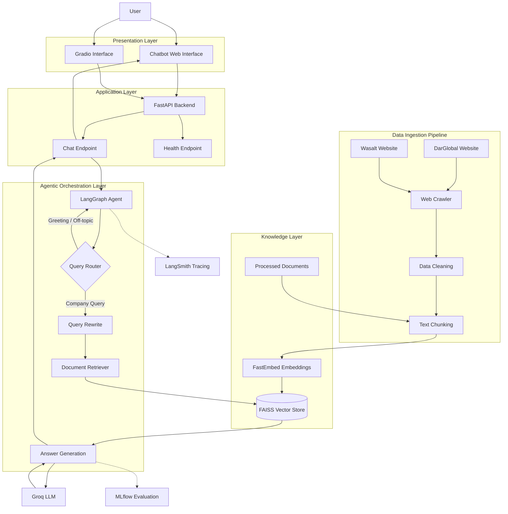

## 4.2 Data Ingestion Architecture

The ingestion pipeline converts website information into searchable vector representations.

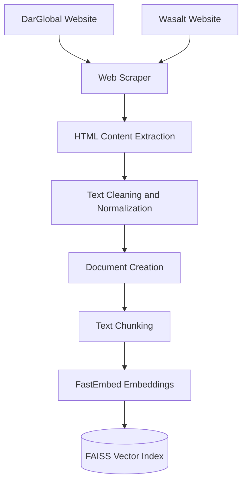

### Ingestion Steps

1. **Data Collection:** Crawl publicly accessible pages from the target websites.
2. **Content Extraction:** Extract meaningful text from collected pages.
3. **Cleaning:** Remove unnecessary HTML and irrelevant content.
4. **Document Creation:** Organize extracted information into documents.
5. **Chunking:** Split large documents into smaller pieces.
6. **Embedding Generation:** Convert chunks into numerical vectors using FastEmbed.
7. **Vector Indexing:** Store embeddings in FAISS for semantic retrieval.

The ingestion process is implemented through the project's scraping and ingestion scripts.

## 4.3 Query Processing Architecture

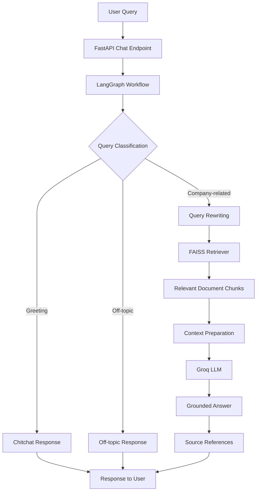

### Query Lifecycle

1. User submits a question.
2. FastAPI receives the request.
3. LangGraph processes the query.
4. The router determines the query category.
5. Company-related questions enter the retrieval workflow.
6. Query rewriting prepares the retrieval query.
7. FAISS searches for relevant document chunks.
8. Retrieved context is passed to the LLM.
9. Groq generates a context-grounded answer.
10. The response and available source references are returned to the interface.

Greetings and off-topic queries are handled separately to avoid unnecessary retrieval.

## 4.4 Layered Architecture (C4-Style Container View)

A container-level view showing what runs where and how the pieces talk to each other.

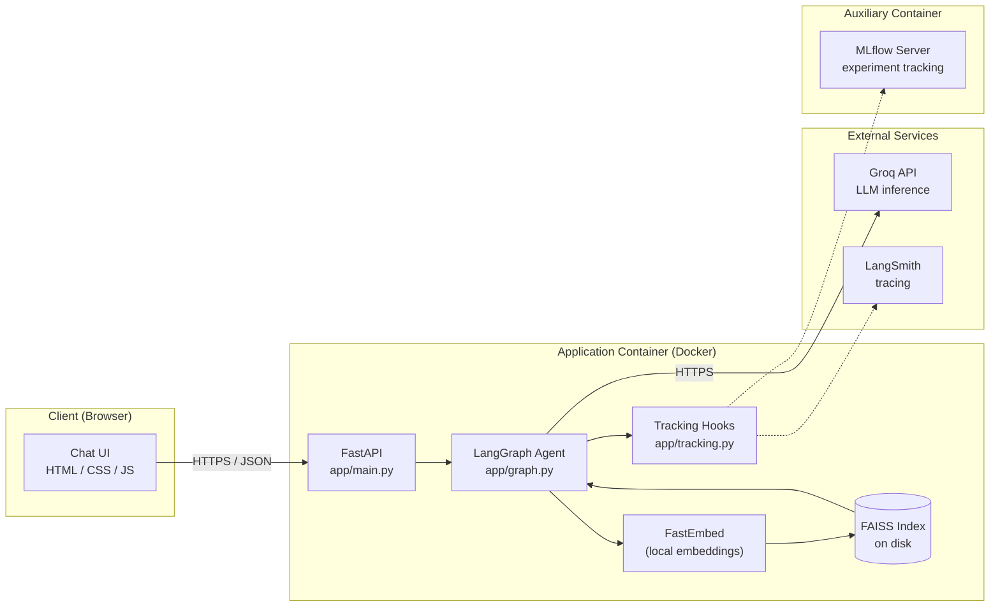

| Container | Responsibility | Scaling Note |
|---|---|---|
| Browser UI | Render chat, call `/api/chat` | Static asset, trivially cacheable |
| FastAPI app | Request handling, validation, orchestration entry | Stateless; can be replicated behind a load balancer |
| LangGraph agent | Routing and RAG workflow | Runs in-process with the app |
| FAISS index | Similarity search over chunk vectors | Loaded into memory; read-only at query time |
| Groq API | LLM generation | External; subject to rate limits |
| MLflow | Metrics and experiment history | Optional auxiliary service |

## 4.5 End-to-End Sequence Diagram

The exact lifecycle of a single company-related question, from click to rendered answer.

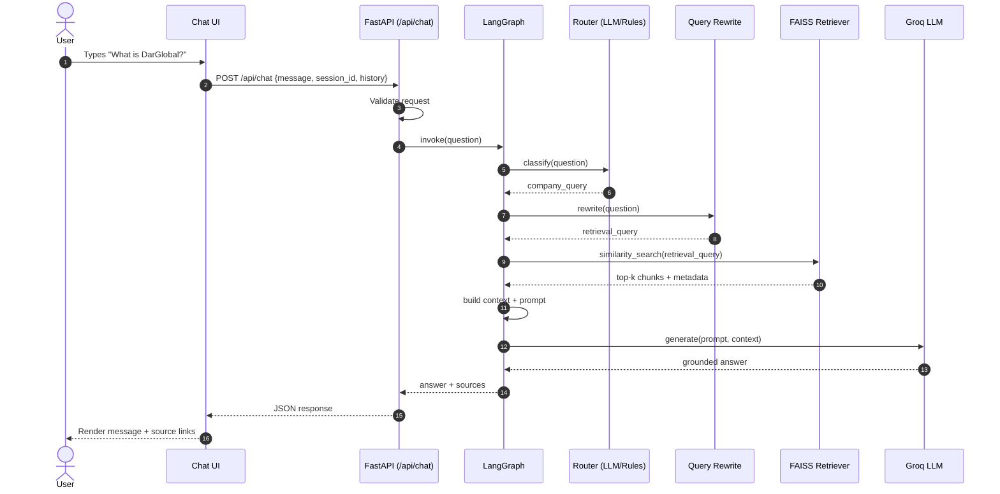

## 4.6 Graph State Design

LangGraph passes a shared **state** object between nodes. The table below describes the logical state the workflow carries.

> ℹ️ This is a conceptual schema to explain the data flow. Exact field names live in `app/graph.py`.

| State Field | Type | Written By | Read By | Purpose |
|---|---|---|---|---|
| `question` | `str` | API entry | Router, Rewrite | Original user input |
| `route` | `str` (`chitchat` / `off_topic` / `company`) | Router | Conditional edge | Decides the path |
| `rewritten_query` | `str` | Query Rewrite | Retriever | Retrieval-optimized query |
| `documents` | `list[Document]` | Retriever | Generator | Retrieved chunks with metadata |
| `context` | `str` | Context builder | Generator | Concatenated chunk text |
| `answer` | `str` | Generator / canned responses | API | Final text |
| `sources` | `list[str]` | Generator | API / UI | Source references |

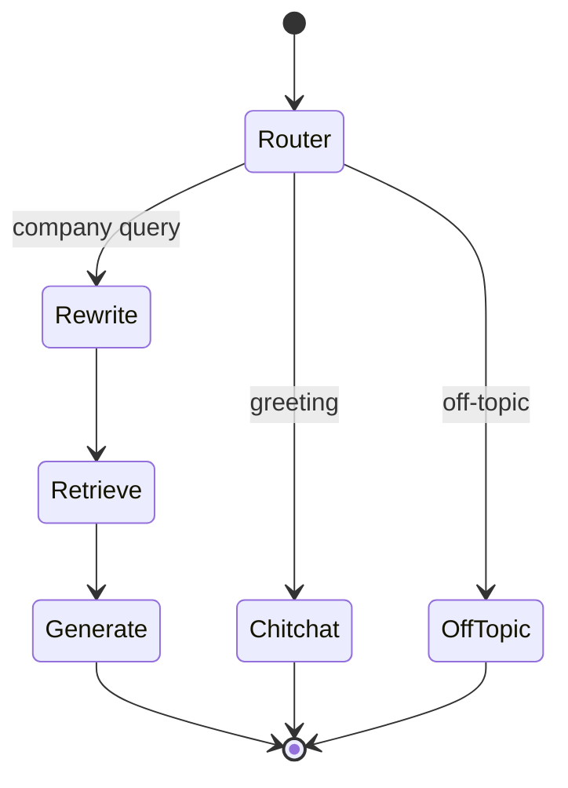

## 4.7 Data Model: Document, Chunk and Vector

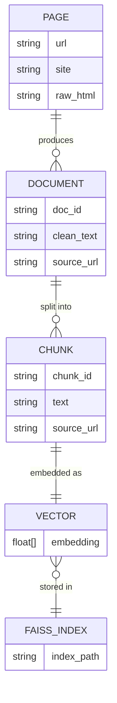

| Entity | Meaning | Why It Matters |
|---|---|---|
| Page | One crawled URL | Origin of every fact |
| Document | Cleaned text of a page | Unit of normalization |
| Chunk | Retrieval-sized text slice | Unit of retrieval |
| Vector | Numeric embedding of a chunk | Enables semantic similarity |
| Source URL (metadata) | Carried from page to chunk | Powers **source attribution** |

## 4.8 Design Principles

| Principle | How It Shows Up in This Project |
|---|---|
| **Separation of concerns** | Ingestion, retrieval, orchestration, API and UI are independent layers |
| **Grounding over guessing** | Answers are built from retrieved context, not from model memory |
| **Fail gracefully** | Fallback handling for unsupported questions |
| **Cheap paths stay cheap** | Greetings and off-topic skip retrieval and heavy generation |
| **Observable by default** | Tracing and experiment tracking integrated |
| **Reproducible** | Docker + pinned requirements + CI checks |
| **Configurable** | Model names and keys come from environment variables |

---

# 5. Technology Stack

| Category | Technology |
|---|---|
| Programming Language | Python |
| LLM Provider | Groq |
| Agent Orchestration | LangGraph |
| LLM Framework | LangChain |
| Vector Database | FAISS |
| Embedding Model | FastEmbed |
| Backend Framework | FastAPI |
| User Interface | HTML, CSS, JavaScript, Gradio |
| Data Collection | Python Web Scraping |
| Observability | LangSmith |
| Experiment Tracking | MLflow |
| Containerization | Docker |
| Container Orchestration | Docker Compose |
| Deployment | Render, Hugging Face Spaces |
| CI/CD | GitHub Actions |
| Testing | Pytest |
| Code Quality | Ruff |
| Version Control | Git and GitHub |

### 5.1 Why These Choices?

| Choice | Reason | Trade-off |
|---|---|---|
| **Groq** | Very low-latency LLM inference, good for chat UX | External dependency; rate limits apply |
| **LangGraph** | Explicit, inspectable graph instead of a hidden chain | Slightly more setup than a single chain |
| **FAISS** | Fast, simple, runs in-process, no separate DB service | Not a managed/distributed store; index lives with the app |
| **FastEmbed** | Lightweight local embeddings, no extra API cost | Embedding quality depends on the chosen model |
| **FastAPI** | Async, typed, automatic `/docs` | Needs ASGI server (uvicorn) |
| **Docker Compose** | One command for app + MLflow | Single-host orchestration only |
| **Render + HF Spaces** | Free/low-cost public deployment | Cold starts on free tiers |

### 5.2 Stack Layer Map

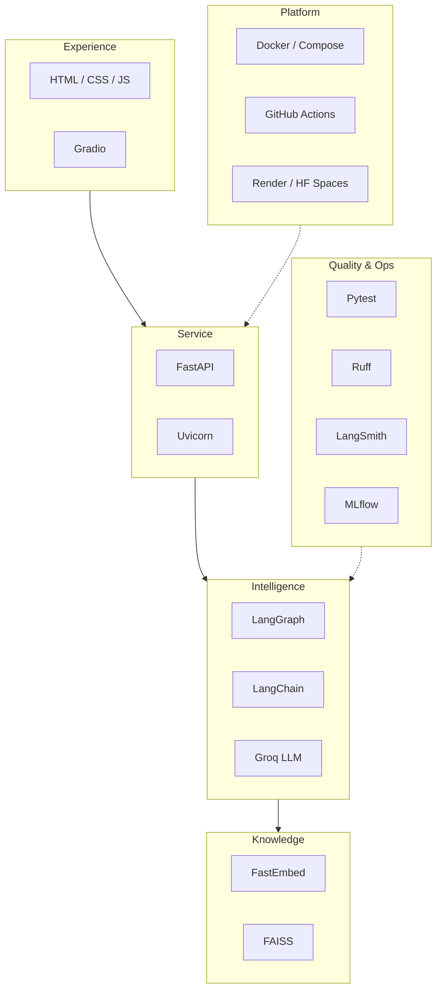

---

# 6. RAG Implementation

Retrieval-Augmented Generation combines information retrieval with LLM-based answer generation.

Rather than asking the LLM to answer entirely from its pretrained knowledge, the system retrieves relevant documents and provides them as context.

### RAG Workflow

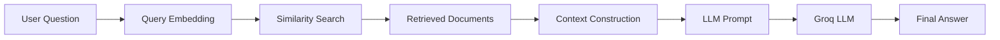

### RAG Components

**1. Document Collection**

Website information is collected and converted into structured documents.

**2. Chunking**

Documents are divided into smaller chunks to improve retrieval relevance and context management.

**3. Embeddings**

FastEmbed converts text into vector representations.

**4. Vector Search**

FAISS performs similarity search to identify relevant document chunks.

**5. Context Construction**

Retrieved chunks are prepared as context for the language model.

**6. Answer Generation**

Groq generates responses using the retrieved context.

**7. Source References**

Relevant source information is included in responses where available.

### 6.1 Offline vs Online Phases

RAG has two distinct phases. Understanding the split is the key to understanding the system.

| Phase | When It Runs | Scripts / Modules | Output |
|---|---|---|---|
| **Offline (indexing)** | Before serving, and on every refresh | `scrape.py` → `ingest.py` | FAISS index + chunk metadata |
| **Online (serving)** | On every user message | `app/graph.py` via `app/main.py` | Answer + sources |

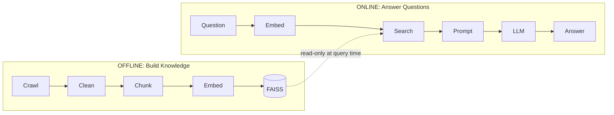

### 6.2 Prompt Construction Pattern

A grounded RAG prompt generally follows this shape (illustrative):

```text
SYSTEM:
  You are an assistant for DarGlobal and Wasalt.
  Answer ONLY using the provided context.
  If the context does not contain the answer, say you don't have that information.

CONTEXT:
  [chunk 1 text]   (source: <url>)
  [chunk 2 text]   (source: <url>)
  ...

USER QUESTION:
  <the user's question>
```

| Prompt Element | Purpose |
|---|---|
| Role instruction | Keeps tone and scope consistent |
| "Use only context" rule | Reduces hallucination |
| Explicit "I don't know" path | Enables safe fallback |
| Source tags | Makes attribution possible |

### 6.3 Retrieval Tuning Knobs

| Knob | Effect | Typical Trade-off |
|---|---|---|
| Chunk size | Bigger = more context per hit; smaller = more precise hits | Too big dilutes relevance; too small loses meaning |
| Chunk overlap | Preserves meaning across boundaries | More storage and duplicates |
| Top-k | How many chunks go to the LLM | Higher k = more recall, more noise and tokens |
| Embedding model | Quality of semantic matching | Quality vs speed vs size |
| Query rewrite | Turns chatty input into a search-friendly query | Extra step adds latency |

---

# 7. Agentic Workflow with LangGraph

LangGraph is used to organize the chatbot's processing logic as a graph-based workflow.

The workflow separates query classification, retrieval, and answer generation into distinct stages.

### Workflow

```text
START
  |
  v
Query Router
  |
  |---- Chitchat ------> Response ------> END
  |
  |---- Off-topic -----> Response ------> END
  |
  |---- Company Query
              |
              v
        Query Rewrite
              |
              v
          Retrieve
              |
              v
          Generate
              |
              v
             END
```

### Why LangGraph?

- Provides structured workflow orchestration.
- Separates different query-handling paths.
- Makes the RAG pipeline modular.
- Improves workflow readability and maintainability.
- Makes future extensions easier.

### 7.1 Node-by-Node Responsibilities

| Node | Input | Output | Notes |
|---|---|---|---|
| **Query Router** | Raw question | Route label | Chooses chitchat / off-topic / company path |
| **Chitchat** | Greeting | Friendly reply | No retrieval, no heavy LLM work |
| **Off-topic** | Unrelated question | Polite redirect | Keeps the bot in scope |
| **Query Rewrite** | Question | Retrieval query | Makes the query search-friendly |
| **Retrieve** | Retrieval query | Top-k chunks | FAISS similarity search |
| **Generate** | Question + context | Answer + sources | Groq LLM, grounded in context |

### 7.2 Routing Decision Table

| User Says | Route | Retrieval? | LLM Generation? |
|---|---|---|---|
| "Hi", "Hello" | Chitchat | ❌ | Light / canned |
| "Who won the cricket match?" | Off-topic | ❌ | Light / canned |
| "What is DarGlobal?" | Company | ✅ | ✅ |
| "What services does Wasalt offer?" | Company | ✅ | ✅ |

### 7.3 Extending the Graph (How to Add a Node)

1. Define the node function (takes state, returns updated state).
2. Register it on the graph.
3. Add an edge or a conditional edge from an existing node.
4. Add a test in `tests/` for the new path.
5. Add a question to `eval/qa.json` to cover the new behavior.

Ideas that fit naturally: a **reranker** node between Retrieve and Generate, a **confidence check** node that triggers fallback, or a **memory** node for multi-turn context.

---

# 8. Backend API

The application uses FastAPI to expose chatbot functionality.

### Main Endpoints

| Method | Endpoint | Purpose |
|---|---|---|
| GET | `/` | Serves the chatbot interface |
| POST | `/api/chat` | Provides API-compatible chatbot interaction |
| POST | `/chat` | Handles chatbot requests |
| GET | `/health` | Checks application health |
| GET | `/docs` | Interactive API documentation |

### Example API Request

```json
{
  "message": "What is DarGlobal?",
  "session_id": "default",
  "history": []
}
```

### Example API Usage

```python
import requests

url = "http://127.0.0.1:8000/api/chat"

payload = {
    "message": "What is DarGlobal?",
    "session_id": "default",
    "history": []
}

response = requests.post(url, json=payload)

print(response.status_code)
print(response.json())
```

Note: The compatibility API accepts a `history` field, but conversational memory should not be assumed unless it is explicitly implemented in the backend.

### 8.1 Request Field Reference

| Field | Type | Required | Description |
|---|---|:---:|---|
| `message` | string | ✅ | The user's question |
| `session_id` | string | ➖ | Identifier for the chat session (default: `"default"`) |
| `history` | array | ➖ | Accepted for compatibility; not guaranteed to be used as memory |

### 8.2 cURL Examples

```bash
# Health check
curl http://127.0.0.1:8000/health

# Ask a question
curl -X POST http://127.0.0.1:8000/api/chat \
  -H "Content-Type: application/json" \
  -d '{"message": "What is DarGlobal?", "session_id": "default", "history": []}'
```

### 8.3 Response Shape

> The exact fields are defined in `app/main.py`. A typical response contains the generated answer and any source references.

```json
{
  "answer": "…generated, context-grounded answer…",
  "sources": ["https://…", "https://…"]
}
```

### 8.4 Request Handling Flow

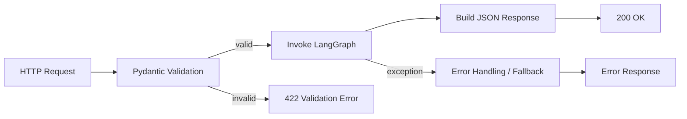

### 8.5 Status Codes

| Code | Meaning | Typical Cause |
|---|---|---|
| `200` | Success | Normal answer |
| `422` | Validation error | Missing or malformed `message` |
| `500` | Server error | Upstream LLM failure, missing index, bad config |

---

# 9. Frontend Architecture

The chatbot interface provides a simple conversational experience.

### Frontend Components

- Chat message interface.
- User and assistant message rendering.
- Quick question suggestions.
- Chat history display.
- New conversation action.
- Loading and response states.
- Source reference display.
- API-based backend communication.
- Responsive styling.

### Frontend Request Flow

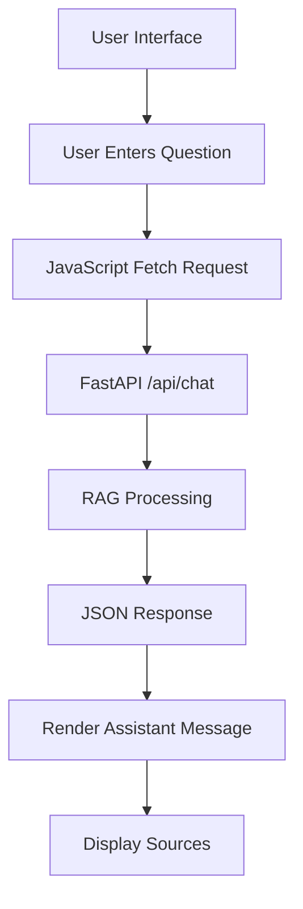

### 9.1 UI State Machine

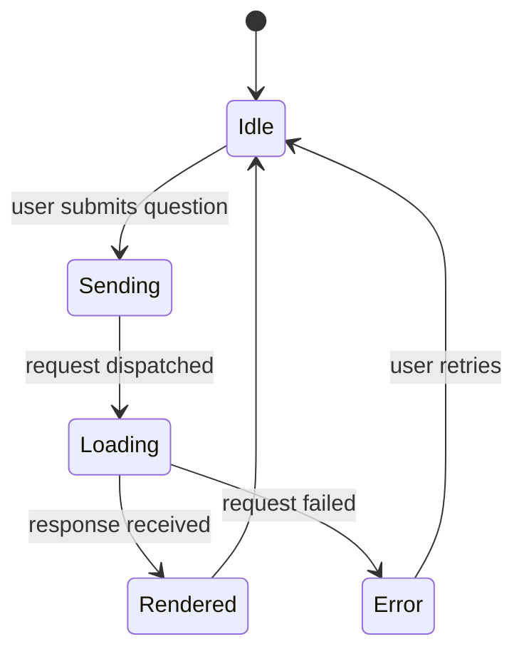

### 9.2 UX Details That Matter

| Element | Why It Is There |
|---|---|
| Quick question chips | Help first-time users start instantly |
| Loading indicator | Signals the LLM is working |
| Source display | Builds trust and enables verification |
| New conversation action | Resets the visible chat |
| Responsive layout | Works on desktop and mobile |

---

# 10. Evaluation and Testing

Testing and evaluation are important for checking application reliability and answer quality.

### Automated Testing

The project uses Pytest for automated tests.

Run:

```bash
pytest -q
```

Latest local test result:

```text
4 passed
```

### Code Quality

Ruff is used for linting and code quality checks.

Run:

```bash
ruff check .
```

Latest result:

```text
All checks passed!
```

### RAG Evaluation

The project includes an evaluation pipeline and curated QA dataset.

Files:

```text
eval/
├── qa.json
├── run_eval.py
└── eval_results.json
```

Run evaluation:

```bash
python eval/run_eval.py
```

### Recorded Evaluation Results

The following results were previously recorded for the evaluation dataset and should be interpreted according to the evaluation script's scoring methodology.

| Metric | Recorded Result |
|---|---:|
| Total Questions | 20 |
| Passed | 20 |
| Failed | 0 |
| Accuracy | 100% |
| Average Score | 100% |
| Average Latency | 2.51 seconds |

These are recorded evaluation results, not a guarantee of production accuracy or performance.

### 10.1 Quality Pyramid

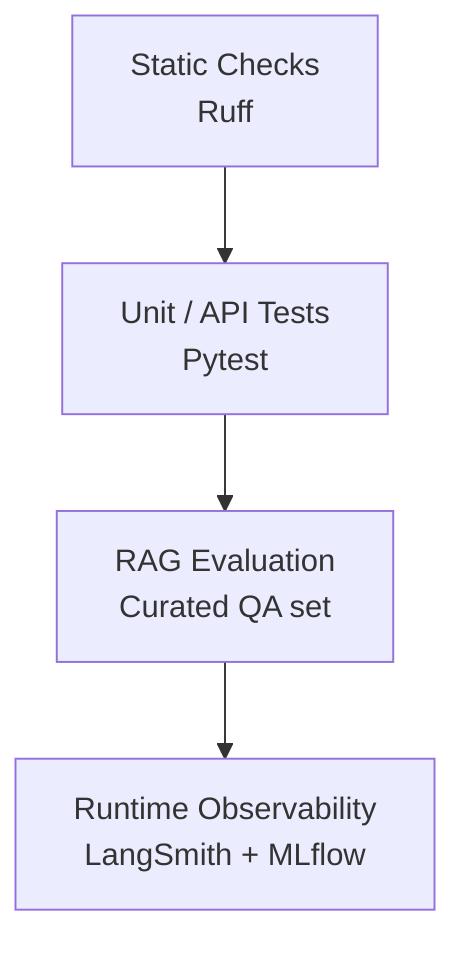

| Layer | Catches | Cadence |
|---|---|---|
| Ruff | Style issues, unused imports, common bugs | Every commit / CI |
| Pytest | Broken endpoints and logic regressions | Every commit / CI |
| QA evaluation | Wrong or missing answers, latency drift | After data/prompt/model changes |
| Tracing | Real-world failures and slow steps | Continuous |

### 10.2 How the Evaluation Loop Works

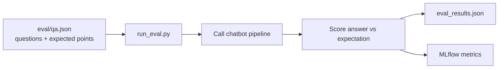

### 10.3 Evaluation Hygiene Tips

| Tip | Reason |
|---|---|
| Keep adding **hard** and **adversarial** questions | A perfect score on an easy set can hide weaknesses |
| Include off-topic and greeting cases | Verifies router behavior |
| Include "answer not in the data" cases | Verifies safe fallback instead of hallucination |
| Re-run after every re-crawl or model change | Detects regressions early |
| Track latency alongside accuracy | Quality and speed must be balanced |

---

# 11. Observability and Experiment Tracking

### LangSmith

LangSmith supports LLM workflow observability.

It can help with:

- Inspecting LLM execution traces.
- Debugging retrieval and generation workflows.
- Understanding model interactions.
- Investigating incorrect responses.
- Monitoring workflow execution.

### MLflow

MLflow supports experiment tracking and evaluation workflows.

It can help with:

- Tracking evaluation experiments.
- Recording metrics.
- Comparing experiment results.
- Organizing model-related experiments.

### 11.1 What to Look at When Something Goes Wrong

| Symptom | Where to Look | Likely Cause |
|---|---|---|
| Wrong answer | LangSmith trace → retrieved chunks | Bad retrieval or stale data |
| Irrelevant sources | Retrieval step | Chunking / embedding / top-k issue |
| Slow responses | Trace timings per node | LLM latency or cold start |
| Accuracy drop after change | MLflow run comparison | Prompt/model/data regression |
| Hallucinated detail | Prompt + context in trace | Context lacked the fact; prompt too permissive |

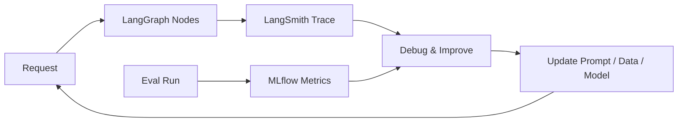

---

# 12. Docker and Deployment Architecture

Docker provides a consistent environment for running the application.

### Docker Architecture

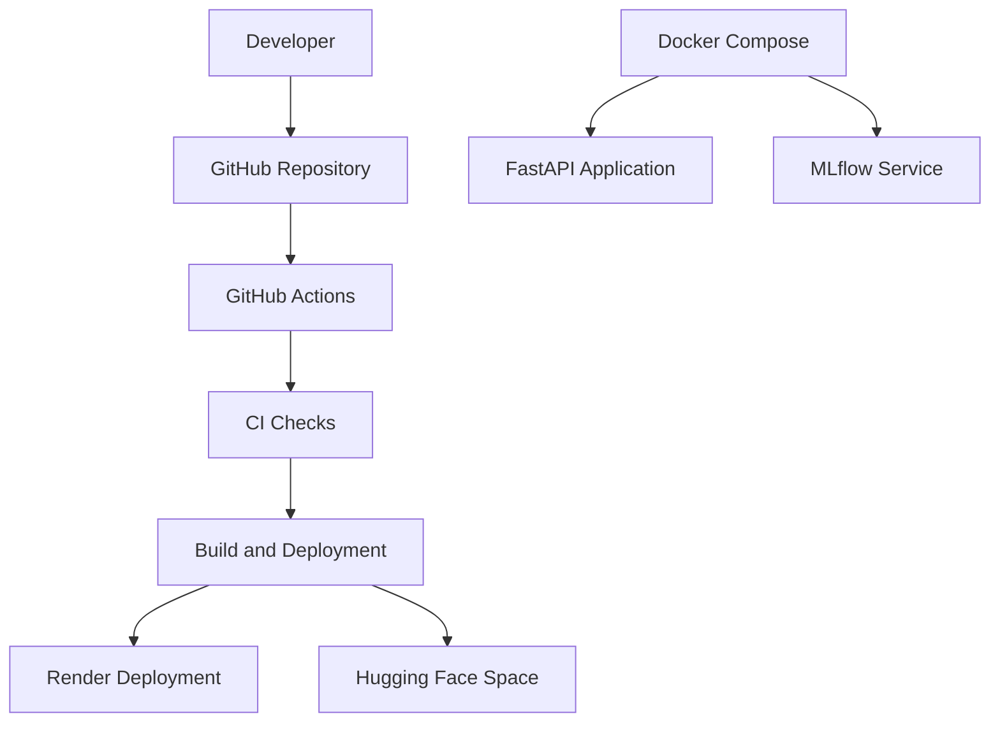

### Run with Docker

Build and start:

```bash
docker compose up --build -d
```

Check containers:

```bash
docker compose ps
```

View application logs:

```bash
docker compose logs --tail=50 app
```

Stop containers:

```bash
docker compose down
```

### Deployment

The application has deployment configurations for:

- Render
- Hugging Face Spaces
- Docker-based local execution

Live application:

https://darglobal-wasalt-ai-powered-rag-chatbot.onrender.com/

Hugging Face Space:

https://huggingface.co/spaces/osamashabih/wasalt-chatbot

### 12.1 Runtime Topology

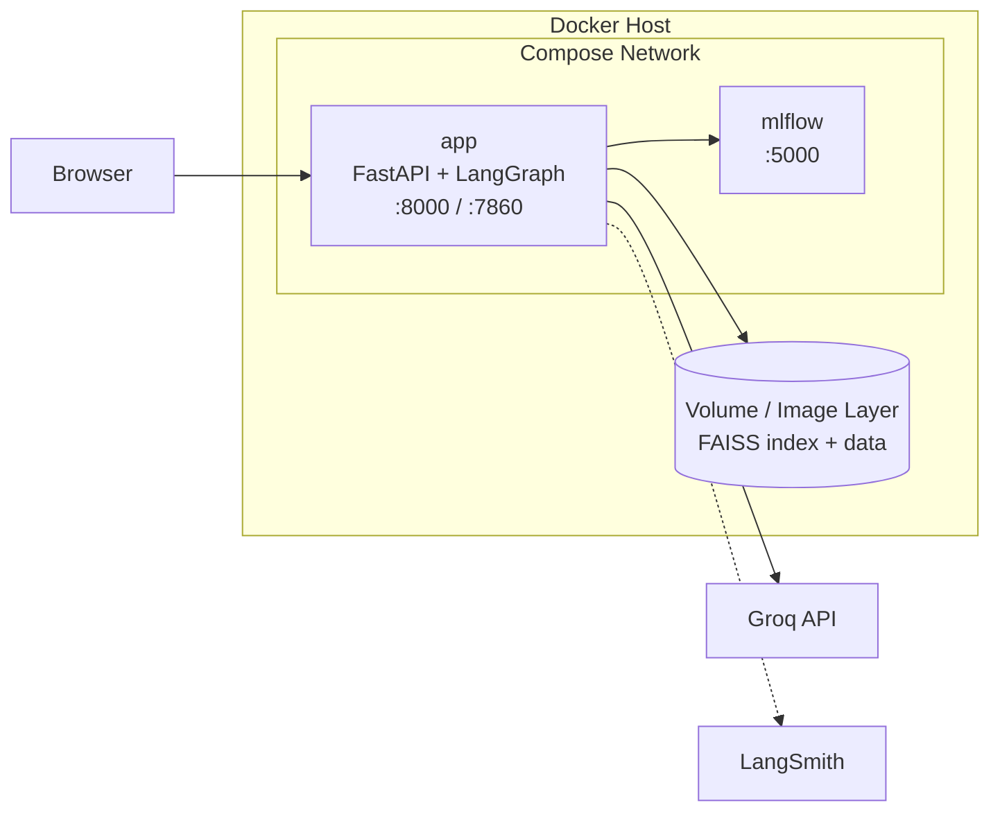

### 12.2 Environment Matrix

| Environment | How It Runs | Typical Use |
|---|---|---|
| Local (Python) | `python app.py` / `uvicorn` | Development |
| Local (Docker) | `docker compose up` | Reproducible testing |
| Render | Cloud web service | Public live demo |
| Hugging Face Spaces | Hosted Space | Public demo and sharing |

### 12.3 Deployment Checklist

- [ ] Secrets set in the platform's environment settings (never in the repo)
- [ ] FAISS index is built and available to the deployed app
- [ ] `/health` returns OK after deploy
- [ ] A sample question returns a grounded answer with sources
- [ ] Logs show no startup errors
- [ ] Tracing keys configured (if observability is wanted)

---

# 13. Project Structure

```text
DarGlobal-Wasalt-AI-Powered-RAG-Chatbot/
│
├── app/
│   ├── graph.py
│   ├── main.py
│   ├── tracking.py
│   └── static/
│       └── index.html
│
├── data/
│
├── docs/
│
├── eval/
│   ├── qa.json
│   ├── run_eval.py
│   └── eval_results.json
│
├── tests/
│
├── .github/
│   └── workflows/
│       ├── ci.yml
│       └── deploy.yml
│
├── app.py
├── scrape.py
├── ingest.py
├── Dockerfile
├── docker-compose.yml
├── requirements.txt
├── requirements-dev.txt
├── .env.example
└── README.md
```

The tree represents the intended major project components; optional generated files and local environment files may differ.

### 13.1 File-by-File Guide

| Path | Role |
|---|---|
| `app/graph.py` | LangGraph workflow: router, rewrite, retrieve, generate |
| `app/main.py` | FastAPI app, endpoints, request validation |
| `app/tracking.py` | LangSmith / MLflow integration helpers |
| `app/static/index.html` | Chat web interface |
| `app.py` | Gradio / combined entrypoint |
| `scrape.py` | Crawls and stores raw website content |
| `ingest.py` | Cleans, chunks, embeds and builds the FAISS index |
| `data/` | Scraped content and generated index artifacts |
| `docs/` | Project documentation assets |
| `eval/` | QA dataset, evaluation runner, results |
| `tests/` | Pytest test suite |
| `.github/workflows/ci.yml` | CI checks (tests + lint) |
| `.github/workflows/deploy.yml` | Deployment workflow |
| `Dockerfile` / `docker-compose.yml` | Container build and multi-service run |
| `requirements*.txt` | Runtime and dev dependencies |
| `.env.example` | Template for required environment variables |

### 13.2 Dependency Direction

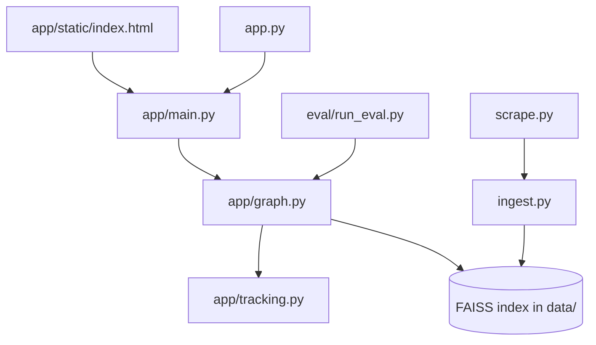

---

# 14. Local Setup and Installation

### Prerequisites

- Python 3.10+
- Git
- Docker Desktop (optional)
- Groq API key

### Step 1: Clone Repository

```bash
git clone https://github.com/osamashabih6960/DarGlobal-Wasalt-AI-Powered-RAG-Chatbot.git

cd DarGlobal-Wasalt-AI-Powered-RAG-Chatbot
```

### Step 2: Create Virtual Environment

```bash
python -m venv .venv
```

Activate on Windows PowerShell:

```powershell
.\.venv\Scripts\Activate.ps1
```

### Step 3: Install Dependencies

```bash
python -m pip install -r requirements-dev.txt
```

### Step 4: Configure Environment Variables

```powershell
Copy-Item .env.example .env
```

Add the required credentials to `.env`.

Example:

```env
GROQ_API_KEY=your_groq_api_key
GROQ_MODEL=your_configured_model
GROQ_FALLBACK_MODEL=your_fallback_model

HF_TOKEN=your_huggingface_token

LANGCHAIN_API_KEY=your_langsmith_api_key
```

Only configure variables required by the selected execution mode.

**Security:** Never commit `.env` or expose API keys in source code, logs, screenshots, or public repositories.

### Step 5: Scrape Website Data

```bash
python scrape.py
```

### Step 6: Build Vector Index

```bash
python ingest.py
```

### Step 7: Start Application

```bash
python app.py
```

### Step 8: Start FastAPI Separately (If Required)

```bash
uvicorn app.main:app --host 0.0.0.0 --port 8000
```

### Step 9: Access Services

| Service | URL |
|---|---|
| Chatbot | http://127.0.0.1:7860 |
| FastAPI | http://127.0.0.1:8000 |
| API Documentation | http://127.0.0.1:8000/docs |
| Health Check | http://127.0.0.1:8000/health |
| MLflow | http://127.0.0.1:5000 |

### 14.1 Setup Roadmap (Visual)

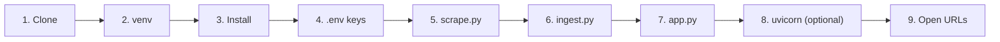

### 14.2 Environment Variable Reference

| Variable | Needed For | Required? |
|---|---|:---:|
| `GROQ_API_KEY` | LLM inference | ✅ |
| `GROQ_MODEL` | Primary model selection | ➖ (if configured) |
| `GROQ_FALLBACK_MODEL` | Backup model | ➖ |
| `HF_TOKEN` | Hugging Face deployment | ➖ |
| `LANGCHAIN_API_KEY` | LangSmith tracing | ➖ |

### 14.3 Verify Your Setup

| Check | Command | Expected |
|---|---|---|
| Tests pass | `pytest -q` | All tests pass |
| Lint clean | `ruff check .` | `All checks passed!` |
| API alive | `curl http://127.0.0.1:8000/health` | Healthy response |
| Answers work | Ask "What is DarGlobal?" | Grounded answer + sources |

### 14.4 Troubleshooting

| Problem | Likely Cause | Fix |
|---|---|---|
| `GROQ_API_KEY` error | Key missing in `.env` | Add the key and restart |
| Empty or irrelevant answers | Index not built | Run `python scrape.py` then `python ingest.py` |
| Port already in use | Another process on 7860 / 8000 | Stop it or change the port |
| Activation blocked on Windows | PowerShell execution policy | Run PowerShell as needed and allow script execution for your user |
| Docker app unhealthy | Missing env or index | Check `docker compose logs --tail=50 app` |
| Slow first response on Render | Free-tier cold start | Wait and retry |

---

# 15. CI/CD Pipeline

GitHub Actions is used to automate project checks and deployment workflows.

### CI/CD Flow

```mermaid
flowchart TD
    A["Developer Pushes Code"] --> B["GitHub Repository"]
    B --> C["GitHub Actions"]
    C --> D["Install Dependencies"]
    D --> E["Run Pytest"]
    E --> F["Run Ruff"]
    F --> G{"Checks Passed?"}
    G -->|"Yes"| H["Deployment Workflow"]
    G -->|"No"| I["Report Failure"]
    H --> J["Deploy to Configured Platform"]
```

The exact deployment behavior depends on the workflow configuration and configured secrets.

### 15.1 Pipeline Stages

| Stage | Tool | Gate |
|---|---|---|
| Install | pip | Dependencies resolve |
| Test | Pytest | All tests pass |
| Lint | Ruff | No violations |
| Deploy | `deploy.yml` | Runs only after checks, per configuration |

### 15.2 Recommended Branch Workflow

```mermaid
gitGraph
    commit id: "main"
    branch feature/improve-retrieval
    checkout feature/improve-retrieval
    commit id: "change"
    commit id: "tests + eval"
    checkout main
    merge feature/improve-retrieval id: "CI green → merge"
```

---

# 16. Security and Responsible Data Usage

- API credentials are stored using environment variables.
- Secret files should be excluded from Git.
- Publicly accessible website information is used for retrieval.
- Website access restrictions should be respected.
- Authentication and access controls should never be bypassed.
- User inputs should be validated by the API.
- Unsupported answers should not be presented as verified facts.
- Source references help users inspect the underlying information.

### 16.1 Threat Model (Overview)

| Threat | Risk | Mitigation |
|---|---|---|
| Leaked API keys | Unauthorized usage and cost | `.env` in `.gitignore`, platform secrets, rotate if exposed |
| Prompt injection via page content | Malicious text in scraped pages steering the LLM | Strict "use context only" instructions; treat retrieved text as data; review sources |
| Prompt injection via user input | User tries to override instructions | Router + scoped system prompt; avoid exposing secrets to the model |
| Hallucination | Confident but wrong statements | Grounded prompting, fallback, source display, evaluation |
| Abuse / flooding | Cost and availability impact | Rate limiting and authentication (see Future Improvements) |
| Stale data | Outdated facts | Scheduled re-crawl and re-index |
| Over-collection | Scraping beyond what is appropriate | Respect site rules and access restrictions |

### 16.2 Security Checklist

- [ ] `.env` is listed in `.gitignore`
- [ ] No keys in code, logs, screenshots or commits
- [ ] Dependencies reviewed and kept updated
- [ ] Inputs validated by the API layer
- [ ] Only publicly accessible pages are crawled
- [ ] Production deployment uses platform secret storage

---

# 17. Current Limitations

- Retrieval quality depends on the coverage and freshness of indexed website data.
- Website changes may require re-crawling and re-indexing.
- Semantic retrieval can occasionally return incomplete or irrelevant context.
- LLM responses can still contain errors.
- API conversation history is accepted for compatibility but is not necessarily used as persistent conversational memory.
- Performance depends on the selected model, hosting resources, and network conditions.

### 17.1 Limitation → Planned Remedy

| Limitation | Planned Remedy |
|---|---|
| Stale / incomplete data | Scheduled refresh, broader crawl coverage |
| Imperfect retrieval | Hybrid BM25 + vector search, reranking |
| LLM errors | Answer verification, confidence thresholds |
| No persistent memory | Session memory store |
| Hosting-dependent latency | Caching, streaming, scalable infrastructure |

---

# 18. Future Improvements

Potential future enhancements include:

- Hybrid retrieval using BM25 and vector search.
- Reranking for improved retrieval relevance.
- Better chunking and metadata filtering.
- Automated scheduled data refresh.
- Retrieval confidence thresholds.
- Stronger answer verification.
- True token streaming.
- Multilingual support, including Arabic.
- Persistent conversation memory.
- Expanded QA evaluation datasets.
- Production monitoring and alerting.
- Authentication and user management.
- Caching and response optimization.
- Scalable vector database infrastructure.

### 18.1 Roadmap

```mermaid
gantt
    title Suggested Improvement Roadmap
    dateFormat  YYYY-MM-DD
    axisFormat  Phase %s
    section Retrieval Quality
    Hybrid BM25 + Vector        :a1, 2026-01-01, 14d
    Reranking                   :a2, after a1, 10d
    Metadata filtering          :a3, after a2, 7d
    section Reliability
    Confidence thresholds       :b1, 2026-01-01, 10d
    Answer verification         :b2, after b1, 14d
    Monitoring and alerting     :b3, after b2, 10d
    section Experience
    Token streaming             :c1, 2026-01-15, 10d
    Arabic / multilingual       :c2, after c1, 21d
    Persistent memory           :c3, after c2, 14d
    section Platform
    Scheduled data refresh      :d1, 2026-02-01, 10d
    Auth and user management    :d2, after d1, 14d
    Scalable vector DB          :d3, after d2, 21d
```

> 📌 Dates are illustrative placeholders to show sequencing, not commitments.

### 18.2 Impact vs Effort

| Improvement | Impact | Effort |
|---|:---:|:---:|
| Reranking | High | Medium |
| Hybrid retrieval | High | Medium |
| Confidence threshold + fallback | High | Low |
| Token streaming | Medium | Medium |
| Scheduled refresh | High | Medium |
| Arabic support | High | High |
| Persistent memory | Medium | Medium |
| Scalable vector DB | Medium (at scale) | High |

---

# 19. Key Engineering Learnings

This project demonstrates practical implementation of:

1. End-to-end Retrieval-Augmented Generation.
2. Web scraping and knowledge-base construction.
3. Embedding generation and vector search.
4. Agentic workflow orchestration using LangGraph.
5. LLM integration using Groq.
6. API development with FastAPI.
7. Frontend-to-backend integration.
8. Evaluation and automated testing.
9. LLM tracing and experiment tracking.
10. Docker-based application packaging.
11. GitHub-based CI/CD workflows.
12. Cloud deployment and environment configuration.

### 19.1 Skills Demonstrated

| Area | Skills |
|---|---|
| **GenAI** | RAG, prompt design, grounding, evaluation |
| **Agents** | Graph-based orchestration, conditional routing |
| **Backend** | FastAPI, validation, health checks |
| **Data** | Crawling, cleaning, chunking, embeddings, vector search |
| **MLOps / LLMOps** | Tracing, experiment tracking, CI/CD |
| **DevOps** | Docker, Compose, cloud deployment |
| **Quality** | Pytest, Ruff, curated eval sets |

---

# 20. Author

**Osama Shabih**

AI Engineer | Generative AI | Agentic AI | RAG Systems

- GitHub: https://github.com/osamashabih6960
- LinkedIn: https://linkedin.com/in/osama-shabih-0b922b28a

---

# Appendices — Deep Dive

> Extra system-design material that goes deeper than the main sections. Appendices are additive and do not change anything above.

## Appendix A: Full System Design Summary

| Dimension | Design |
|---|---|
| **Architecture style** | Modular monolith (single deployable app) + external LLM API |
| **Data flow** | Batch ingestion (offline) + request/response serving (online) |
| **State** | Stateless API; read-only vector index; no guaranteed chat memory |
| **Consistency** | Index is rebuilt in batch; answers reflect the last ingestion |
| **Failure strategy** | Fallback model, safe "not found" answers, error responses |
| **Observability** | Traces (LangSmith) + experiments (MLflow) |
| **Deployment** | Containerized; Render and Hugging Face Spaces |

## Appendix B: Functional vs Non-Functional Requirements

| Type | Requirement | How It Is Addressed |
|---|---|---|
| Functional | Answer company questions | RAG pipeline |
| Functional | Show where answers come from | Source attribution |
| Functional | Handle greetings and off-topic | Router paths |
| Non-functional | Low latency | Groq inference, skipping retrieval on simple queries |
| Non-functional | Reliability | Fallback model, health endpoint, tests |
| Non-functional | Maintainability | Modular graph, linting, CI |
| Non-functional | Observability | LangSmith + MLflow |
| Non-functional | Portability | Docker |
| Non-functional | Security | Env-based secrets, input validation |

## Appendix C: Latency Budget (Conceptual)

Where time goes in one company-related request. Measure real values in LangSmith traces; the **recorded average end-to-end latency was 2.51 seconds** on the evaluation set.

```mermaid
flowchart LR
    A["Validate<br/>~ms"] --> B["Route<br/>small"]
    B --> C["Rewrite<br/>small"]
    C --> D["Embed + Search<br/>small"]
    D --> E["LLM Generate<br/>largest share"]
    E --> F["Respond<br/>~ms"]
```

| Step | Relative Cost | Optimization Idea |
|---|---|---|
| Routing | Low | Rule-based shortcuts for obvious greetings |
| Query rewrite | Low–Medium | Skip for already-clear queries |
| Embedding + search | Low | Keep index in memory |
| LLM generation | **Highest** | Smaller model, shorter context, streaming |
| Network | Variable | Region placement, keep-alive |

## Appendix D: Scalability Plan

```mermaid
flowchart LR
    S1["Stage 1<br/>Single container<br/>(current)"] --> S2["Stage 2<br/>Multiple app replicas<br/>behind load balancer"]
    S2 --> S3["Stage 3<br/>Dedicated vector DB<br/>+ cache layer"]
    S3 --> S4["Stage 4<br/>Async ingestion workers<br/>+ scheduled refresh"]
```

| Stage | Change | Benefit |
|---|---|---|
| 1 (current) | One app with in-process FAISS | Simplicity, low cost |
| 2 | Horizontal replicas | Higher throughput |
| 3 | Managed vector DB, response cache | Shared index, lower repeat latency |
| 4 | Background ingestion jobs | Always-fresh knowledge |

## Appendix E: Failure Modes and Handling

| Failure | Detection | Handling |
|---|---|---|
| Groq API error / rate limit | Exception from LLM call | Retry or use fallback model; return a friendly error |
| Missing FAISS index | Startup / first query error | Fail clearly; instruct to run `ingest.py` |
| No relevant context found | Weak or empty retrieval | Answer that information isn't available rather than guessing |
| Malformed request | Validation layer | `422` response |
| Upstream slowness | Trace timings | Timeouts and streaming (future) |

```mermaid
flowchart TD
    A["LLM Call"] --> B{"Success?"}
    B -->|"Yes"| C["Return Answer"]
    B -->|"No"| D{"Fallback Model Configured?"}
    D -->|"Yes"| E["Retry with Fallback"]
    D -->|"No"| F["Return Friendly Error"]
    E --> G{"Success?"}
    G -->|"Yes"| C
    G -->|"No"| F
```

## Appendix F: Data Refresh Strategy

```mermaid
flowchart LR
    A["Schedule / Manual Trigger"] --> B["scrape.py"]
    B --> C["ingest.py"]
    C --> D["New FAISS Index"]
    D --> E["Run eval/run_eval.py"]
    E --> F{"Quality OK?"}
    F -->|"Yes"| G["Deploy New Index"]
    F -->|"No"| H["Investigate and Fix"]
```

| Step | Why |
|---|---|
| Re-scrape | Capture website changes |
| Re-ingest | Rebuild vectors for new content |
| Re-evaluate | Prevent silent regressions |
| Redeploy | Serve fresh knowledge |

## Appendix G: Contribution Guide

1. **Fork** the repository and create a feature branch.
2. Set up the environment ([Section 14](#14-local-setup-and-installation)).
3. Make your change in small, focused commits.
4. Run `pytest -q` and `ruff check .`.
5. If behavior changed, add or update questions in `eval/qa.json` and run `python eval/run_eval.py`.
6. Open a pull request describing **what** changed and **why**.
7. Wait for CI to pass before requesting review.

| Do | Don't |
|---|---|
| Add tests for new paths | Commit secrets or `.env` |
| Keep functions focused | Bypass website access restrictions |
| Update docs when behavior changes | Claim accuracy without evaluation |

## Appendix H: FAQ

**Q1. Does the chatbot remember previous messages?**
The API accepts a `history` field for compatibility, but persistent conversational memory should not be assumed unless it is implemented in the backend.

**Q2. Where do the answers come from?**
From the indexed content of the DarGlobal and Wasalt websites, retrieved via FAISS and passed to the Groq LLM as context.

**Q3. Why might an answer be incomplete?**
The index only contains what was crawled, and retrieval can miss relevant chunks. Re-crawling and improving retrieval helps.

**Q4. Is the 100% evaluation score a guarantee?**
No. It reflects a curated 20-question set and the script's scoring method, not production-wide accuracy.

**Q5. Can I swap the LLM?**
Yes, model names are configurable through environment variables; deeper provider changes would be made in the generation layer.

**Q6. Can I add more websites?**
Yes. Extend the scraping targets, re-run `scrape.py` and `ingest.py`, then re-evaluate.

## Appendix I: Glossary

| Term | Meaning |
|---|---|
| **RAG** | Retrieval-Augmented Generation: fetch relevant text, then generate an answer from it |
| **Embedding** | A numeric vector representing the meaning of text |
| **Vector store** | A database/index for similarity search over embeddings |
| **FAISS** | Library for fast similarity search over vectors |
| **Chunk** | A small piece of a document used as a retrieval unit |
| **Top-k** | The number of best-matching chunks retrieved |
| **Grounding** | Constraining answers to provided context |
| **Hallucination** | Fluent but unsupported or false model output |
| **LangGraph** | Framework for building stateful, graph-based LLM workflows |
| **Router** | Component that decides which path a query takes |
| **Reranking** | Re-ordering retrieved chunks by relevance |
| **BM25** | Classic keyword-based ranking algorithm |
| **Tracing** | Recording each step of an LLM workflow for debugging |

## Appendix J: Architecture Decision Records (ADR Summary)

| # | Decision | Context | Consequence |
|---|---|---|---|
| ADR-1 | Use RAG instead of fine-tuning | Content changes with the websites | Easy to refresh by re-indexing; no retraining |
| ADR-2 | Use LangGraph for orchestration | Need distinct paths for chitchat, off-topic, company queries | Clear, extensible workflow |
| ADR-3 | Use FAISS in-process | Small corpus, simple deployment | Fast and cheap; limited horizontal sharing |
| ADR-4 | Use local FastEmbed embeddings | Avoid per-call embedding cost | Lightweight; quality tied to model choice |
| ADR-5 | Use Groq for inference | Low latency for chat | External dependency and rate limits |
| ADR-6 | Return sources with answers | Trust and verifiability | Requires carrying metadata through the pipeline |
| ADR-7 | Containerize with Docker | Reproducible deployment | Consistent across local and cloud |

---

<p align="center">
  <b>Built with Python, LangGraph, FastAPI, FAISS, Groq and Generative AI.</b>
</p>

<p align="center">
  ⭐ If you find this project useful, consider giving the repository a star!
</p>
